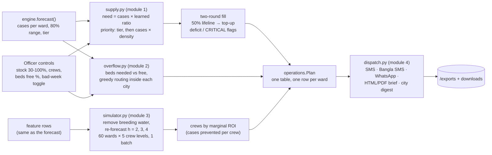

# Architecture

DengueWatch forecasts weekly dengue cases for each of 60 wards **2, 3 and 4 weeks ahead**, turns them into Low / Medium / High / Critical tiers, and explains each forecast. The goal is to give city health officers a 2-4 week early-warning window before hospital admissions rise.

**Phase 2 (onsite final)** turns that forecast into an operational command center: how many saline bags, test kits, beds and spraying crews each ward gets when stock is short, where overflow patients go, what crews would prevent, and the dispatch notices to send. Sections 1-6 describe the forecasting core from Phase 1; **section 7** describes the Phase 2 modules.

## 1. Data flow

```mermaid
flowchart LR
  A["data/bangladesh_dengue.csv<br/>(fallback: official Google Sheet, downloaded once)"] --> B["data.py<br/>schema check, cleaning"]
  B --> C["features.py<br/>per-ward lags: rain 0-6 wks,<br/>humidity 0-4, temp 0-6,<br/>rolling rain sums, season"]
  C --> D["scripts/train.py<br/>chronological split,<br/>backtest, metrics.json"]
  D --> E[("models/dengue_models.joblib<br/>3 models + interval tables")]
  W["Open-Meteo forecast API<br/>1 call for all 5 cities"] -. "6 h disk cache<br/>→ stale cache → climatology" .-> C
  E --> F["engine.py<br/>predict + 80% range"]
  F --> G["tiers.py + explain.py<br/>tiers, escalation flag,<br/>Shapley driver breakdown"]
  G --> H["Streamlit dashboard<br/>(app.py + views/)"]
  G -. "≤5 wards as compact JSON,<br/>cached by hash" .-> L["Optional LLM briefing<br/>(template fallback)"] --> H
```

Code layout: `src/dengue/` holds all logic and has no Streamlit dependency (so Phase 2 can add an API or a scheduled job), `views/` holds one file per dashboard page, `scripts/train.py` rebuilds everything, `tests/` checks lag correctness, leakage and explanation maths.

## 2. Features: the "breeding clock"

Rain → stagnant water → 7-14 days for *Aedes* larvae to become adults → viral incubation → symptoms. In this dataset, weekly cases correlate most with **rainfall 3 weeks earlier (r = 0.75)**, versus 0.53 for same-week rain. Features, all computed with `groupby("ward_id").shift(k)` so a ward never reads another ward's weather:

| Group | Features |
|---|---|
| Rainfall | weekly rain at lags 0-6, rolling 2/4/6-week totals |
| Humidity | lags 0-4 |
| Temperature | average temperature at lags 0, 2, 4, 6; this week's max-min range |
| Ward vulnerability | population density, water-logging index, sanitation score |
| Season | week-of-year as sine/cosine |

A forecast issued in week *t* uses only data up to *t*. The target is cases in week *t + h*.

## 3. Chronological validation split

Nothing is shuffled. Training rows are filtered by the date of the **target week**, so no label from a later period leaks in.

| Period | Role |
|---|---|
| 2016-2022 | Training |
| 2023 | Validation: model settings and tier thresholds |
| 2024-2025 | Test: the shipped model (trained 2016-2023) is scored once; the dashboard replays these unseen weeks |
| 2019-2025 | Extra expanding-window backtest: for each year Y, train on all earlier years, test on Y |

**Test results, 2024-2025** (cases per ward per week; naive = "same as this week"):

| Horizon | MAE Jun-Oct | Naive MAE Jun-Oct | MAE all weeks | RMSE | High/Critical recall | 80% range coverage |
|---|---|---|---|---|---|---|
| 2 weeks | 2.27 | 3.65 | 1.05 | 2.22 | 85% | 83% |
| 3 weeks | **2.19** | 4.14 | 1.02 | 2.02 | 85% | 83% |
| 4 weeks | 2.57 | 4.44 | 1.19 | 2.40 | 82% | 83% |

The 3-week model has 47% lower in-season error than the naive forecast and beats it in every backtest year from 2019 to 2025. It also generalises to wards it has never seen: with 10 of the 60 wards held out of training, test MAE was 1.12 on those wards versus 1.02 on the rest, because the model learns from ward *attributes*, not ward names.

## 4. Model choice and rationale

- **HistGradientBoostingRegressor with a Poisson loss** (scikit-learn), one per horizon. Cases are non-negative counts with 58% zeros, and Poisson handles that naturally. Boosted trees capture non-linear lag effects and interactions (rain × water-logging) that a linear model misses. They train in seconds on a CPU and install cleanly with pip on Windows, macOS and Linux.
- **Monotonic constraints** encode domain knowledge: more rain, worse drainage or higher density can never *lower* predicted risk, and better sanitation can never raise it. This keeps forecasts and what-if answers physically sensible.
- **Rejected:** LSTM/Prophet (needs more data, slower, hard to explain to officers), plain linear regression (misses interactions), static threshold rules (no learning).
- **80% ranges by split-conformal calibration.** We refit on earlier years, forecast the following unseen year, and take the 10th/90th percentiles of those errors per forecast-size bin. Coverage on the test set is 83%. Quantile-loss boosting was tried and rejected: it collapsed to 0 on this zero-heavy target.
- **Tiers** (forecast cases per ward per week): Low < 2, Medium 2-5, High 5-10, Critical ≥ 10, which sit at about the 66th, 78th and 90th percentiles of all historical ward-weeks. An **escalating** flag marks wards that are Low/Medium today but forecast High+, where early action pays off most.
- **Driver breakdown: exact Shapley values over 4 driver groups.** We compare against a reference: a typical ward with typical weather for that week of the year. All 16 combinations of "real vs reference" groups are scored in one batched call. Contributions add up exactly to the forecast.

## 5. Efficiency and cost controls

| Control | Implementation | Measured |
|---|---|---|
| Serialized models | `joblib` bundle loaded once per server (`st.cache_resource`); retrained automatically only if the data hash or scikit-learn version changes | 1.1 MB file; data + model load ≈ 0.3 s |
| Fast inference | one vectorised call for all wards; explanations batched (60 wards × 16 variants in one call) | 60 wards scored in ≈ 4 ms; full board with explanations ≈ 60 ms |
| UI caching | `st.cache_data` on (week, horizon, city, what-if) | repeat views cost no recomputation |
| Training cost | CPU-only, no GPU | 3 shipped models in ≈ 8-11 s; full evaluation in ≈ 35 s |
| Weather API minimisation | **one** Open-Meteo request covers all 5 cities (comma-separated coordinates), with only the 5 daily variables needed; wards inherit city weather | at most 1 call per 6 hours; 0 calls when cached |
| Dataset download | bundled CSV first; the Google Sheet is fetched only if the file is missing, then saved | 0 calls normally |
| LLM token control (optional) | off by default; input is a compact JSON of ≤ 5 wards (≈ 250 tokens); output capped at 300 tokens; reasoning tokens disabled; responses cached on disk by SHA-256 of the input; daily call budget (`LLM_DAILY_CALL_BUDGET`); token usage shown in the sidebar | repeat briefings cost 0 tokens |

## 6. Network failures and rate limits

All external calls go through `src/dengue/http.py`:

- timeouts on every request;
- up to 4 attempts with exponential backoff and jitter (0.5 s, 1 s, 2 s, ...), honouring `Retry-After` on HTTP 429;
- a **circuit breaker**: after 3 consecutive failures, the service is skipped for 10 minutes instead of hammering it;
- graceful fallbacks: weather goes from fresh cache to stale cache to climatology (each city's median weather for that week of the year), and the briefing falls back to the template. The UI shows which source was used instead of crashing;
- `ALLOW_NETWORK=0` runs fully offline. The core dashboard needs no network or API keys at all.
- These paths are tested (`tests/test_resilience.py`) with a fake HTTP session: 429 + `Retry-After`, growing backoff, no retry on 4xx, breaker opening, stale-cache and climatology fallbacks, LLM failure, cache hits and the daily budget. GitHub Actions runs the whole suite on Linux and Windows on every push.

## 7. Phase 2: from forecast to action (command center)

### 7.1 Data flow

Everything in this diagram is local Python (pandas, NumPy and the saved scikit-learn models). None of it calls the internet, so it is unaffected by the offline kill switch (module 5). Code: `src/dengue/{supply,overflow,simulator,operations,dispatch}.py`; pages: `views/{allocation,overflow,simulator,dispatch}.py`; shared controls: `ui_ops.py`.

### 7.2 Module 1: constrained resource allocation (`supply.py`)

1. **Ratios are learned, not typed in.** The onsite dataset adds `saline_bags_needed`, `diagnostic_kits_needed` and `hospital_beds_required` per ward-week. Because these grow with cases, we learn one number per item from the training years (2016-2023): ratio = total units ÷ total cases = **2.378 saline bags, 1.147 kits and 0.290 beds per case**. On the unseen 2024-2025 weeks, `round(cases × ratio)` is off by 0.002 bags, 0.021 kits and 0.011 beds per ward-week on average (`tests/test_supply.py`).
2. **Need** per ward = round(planned cases × ratio). Planned cases = the forecast, or with *Plan for a bad week* the top of its 80% range.
3. **Priority** = tier first (Critical > High > Medium > Low); inside a tier, *crowded cases* = forecast cases × (ward density ÷ median density). So of two wards with the same cases, the denser one is served first (`population_density_sqkm`).
4. **Scarcity.** Regional stock = slider % × total need (30-100%). It is shared in **two greedy rounds, both in priority order**: round 1 gives every ward a 50% lifeline, round 2 tops wards up to 100%. Pure greedy would leave the lowest-priority wards with nothing even though their patients need saline just as much; pure proportional sharing ignores priority. The two rounds do both, and stay explainable in one sentence.
5. **Deficit flags**, live on every slider move: fill below 100% = *Short*; below the 50% lifeline = **CRITICAL** (fill = the worst-covered item).
6. **Crews.** High wards ask for 1 crew, Critical wards for 2. Available crews are assigned by the simulator's ROI rule (7.4), and the gap is reported.

### 7.3 Module 2: hospital surge and overflow routing (`overflow.py`)

- **Bed capacity is a stated assumption** because the dataset has no bed counts: each city's dengue bed pool = the beds it needed in 95% of training weeks (it coped then), split between its wards by population density ("hospitals follow people, dengue follows water"). The *Dengue beds free* slider scales it (30-100%) to test a crunch.
- **Routing, per city, never across a city boundary** (Dhaka North, Dhaka South, Chattogram, Gazipur, Narayanganj): overflow = needed − free. Take the ward with the largest overflow and move patients to the ward with the most free beds, then the next, until it fits or the city is full. Repeat.
- **Output:** transfer orders (from, to, patients), per-ward overflow / sent / received / **net deficit**, and per-city utilisation, **headroom left** and patients with no bed. Tests check that patients are conserved, no ward goes over capacity and no transfer leaves its city (`tests/test_overflow.py`).

### 7.4 Module 3: what-if vector-control simulator (`simulator.py`)

A **model-driven counterfactual**, not a fixed percentage. The forecast model learned that rain 0-6 weeks ago drives cases 2-4 weeks later (rain → standing water → larvae → mosquitoes → cases). A larvicide/fogging crew destroys part of that standing water, so we ask the same trained model what it would forecast with less breeding water:

- coverage(c crews) = 1 − (1 − 0.20)^c → 20%, 36%, 49%, 59% for 1-4 crews (diminishing returns, max 4 per ward). The 20% is an editable assumption (`config.CREW_COVERAGE`, and a 10-30% slider on the page to test sensitivity).
- Treated features: rain lags 0, 1, 2 × (1 − coverage), rolling rain totals rebuilt.
- Cases prevented = forecast(no crews) − forecast(with crews) at **2, 3 and 4 weeks ahead**; beds and saline saved = cases prevented × the learned ratios.
- **ROI = cases prevented over weeks 2-4 ÷ crews.** Wet, dense, badly drained wards gain most, because that is where the model's response to rain is strongest.
- **Best plan:** crews are sent one at a time, each to the ward where the *next* crew prevents the most cases (greedy on marginal gain; this is optimal when each extra crew in a ward adds less than the one before, which the diminishing coverage formula makes the normal case).
- **Cost:** all 60 wards × 5 crew levels × 3 horizons = 900 rows scored in one batch, about 30 ms. The model's monotonic rain constraint guarantees that more crews never raise a forecast (tested).

### 7.5 Module 4: dispatch notices (`dispatch.py`)

Fixed templates filled from the plan row, so a notice can never contain a number the plan does not have, and they need no AI and no internet:

| Format | For | Contents |
|---|---|---|
| SMS (≤ 160 plain characters, tested) | ward health officer | cases + tier, saline and kits allocated/required, beds needed/free and transfers, crews, status |
| Bangla SMS (Unicode) | field staff | the same in Bangla words and digits |
| WhatsApp | ward / city groups | structured message with bold labels, deficit alert, expected effect of crews |
| HTML brief (print → one ward per page) and PDF | ward commissioner | forecast, required vs allocated table with deficits, action list |
| City digest | city health officer | bed use, transfers, headroom, total supplies and crews per city |

Samples for the 23 June 2025 replay week (60% stock, 20 crews, 80% beds free) are in [`exports/`](exports/); regenerate with `python scripts/export_dispatch.py --stock 60 --crews 20 --beds 80`. The Dispatch page also downloads one ward's brief (HTML/PDF) or a ZIP of all notices.

### 7.6 Module 5: offline resilience and deterministic fallback

- **What needs the internet:** only the optional live weather (Open-Meteo) and the optional Gemini rewording. Forecasting, allocation, routing, the simulator and every notice are local and deterministic: same inputs, same outputs, no randomness.
- **Kill switch:** the sidebar's *Offline mode* toggle (or `ALLOW_NETWORK=0`) cuts every outbound call at once; pages show an offline banner. Without the toggle, a real Wi-Fi loss is handled by the Phase 1 network layer (timeouts, retries, circuit breaker, cache → climatology, LLM → template).
- **Tested:** `tests/test_offline.py` blocks every socket and DNS lookup while the network setting is still on and a fake Gemini key is set, then runs the engine, the full plan, the exports, the LLM fallback and every dashboard page, asserting zero exceptions.
- Fonts are bundled and charts render in the browser, so the UI looks the same offline.

### 7.7 Efficiency (measured in our test environment, CPU only)

| Step | Time |
|---|---|
| Crew effect table (900 predictions, one batch) | ≈ 30 ms per week, cached per (week, city, crew effect) |
| Full plan: allocation + routing + crew assignment | ≈ 65 ms |
| 60 SMS + Bangla SMS + WhatsApp notices | ≈ 6 ms |
| 60-page PDF of briefs | ≈ 0.2 s |

Ratios and bed capacity are computed once per server. `st.cache_data` keys the plan on (week, horizon, city, stock, crews, beds, bad-week), so moving a slider back costs nothing.

### 7.8 Assumptions to state in Q&A

| Assumption | Value | Why | Where to change |
|---|---|---|---|
| Supplies per case | learned 2.378 / 1.147 / 0.290 | from the onsite data, checked on unseen years | data |
| Ward bed capacity | city 95th-percentile need, split by density | dataset has no bed counts | `BED_CAPACITY_QUANTILE` |
| Lifeline share | 50% | nobody with patients gets nothing | `CRITICAL_FILL` |
| One crew's effect | 20% of breeding water from the last 3 weeks | planning assumption, slider 10-30% | `CREW_COVERAGE` |
| Crews requested | High 1, Critical 2, max 4 per ward | simple, matches tiers | `CREWS_NEEDED`, `MAX_CREWS_PER_WARD` |

## 8. Scaling to a live system

- New weekly data: upload on the **Add weekly data** page or run `python scripts/ingest.py new_weeks.csv`. Rows are validated and stored in `data/updates.csv` (never overwriting the official file), then the models retrain on all data in about 15 s and the app reloads via the data hash. `--reset` restores the official dataset.
- New wards: the model uses ward attributes, so new wards work without retraining the architecture.
- New consumers: `Engine` in `src/dengue/engine.py` is UI-independent and can be wrapped in a REST endpoint or a weekly batch job that emails the priority list.
