# Architecture

DengueWatch forecasts weekly dengue cases for each of 60 wards **2, 3 and 4 weeks ahead**, turns them into Low / Medium / High / Critical tiers, and explains each forecast. The goal is to give city health officers a 2-4 week early-warning window before hospital admissions rise.

## 1. Data flow

```mermaid
flowchart LR
  A["data/bangladesh_dengue.csv<br/>(fallback: official Google Sheet, downloaded once)"] --> B["data.py<br/>schema check, cleaning"]
  B --> C["features.py<br/>per-ward lags: rain 0-6 wks,<br/>humidity 0-4, temp 0-6,<br/>rolling rain sums, season"]
  C --> D["scripts/train.py<br/>chronological split,<br/>backtest, metrics.json"]
  D --> E[("models/dengue_models.joblib<br/>3 models + interval tables")]
  W["Open-Meteo forecast API<br/>1 call for all 5 cities"] -. "6 h disk cache<br/>→ stale cache → climatology" .-> C
  E --> F["engine.py<br/>predict + 80% range"]
  F --> G["tiers.py + explain.py<br/>tiers, escalation flag,<br/>Shapley driver breakdown"]
  G --> H["Streamlit dashboard<br/>(app.py + views/)"]
  G -. "≤5 wards as compact JSON,<br/>cached by hash" .-> L["Optional LLM briefing<br/>(template fallback)"] --> H
```

Code layout: `src/dengue/` holds all logic and has no Streamlit dependency (so Phase 2 can add an API or a scheduled job), `views/` holds one file per dashboard page, `scripts/train.py` rebuilds everything, `tests/` checks lag correctness, leakage and explanation maths.

## 2. Features: the "breeding clock"

Rain → stagnant water → 7-14 days for *Aedes* larvae to become adults → viral incubation → symptoms. In this dataset, weekly cases correlate most with **rainfall 3 weeks earlier (r = 0.75)**, versus 0.53 for same-week rain. Features, all computed with `groupby("ward_id").shift(k)` so a ward never reads another ward's weather:

| Group | Features |
|---|---|
| Rainfall | weekly rain at lags 0-6, rolling 2/4/6-week totals |
| Humidity | lags 0-4 |
| Temperature | average temperature at lags 0, 2, 4, 6; this week's max-min range |
| Ward vulnerability | population density, water-logging index, sanitation score |
| Season | week-of-year as sine/cosine |

A forecast issued in week *t* uses only data up to *t*. The target is cases in week *t + h*.

## 3. Chronological validation split

Nothing is shuffled. Training rows are filtered by the date of the **target week**, so no label from a later period leaks in.

| Period | Role |
|---|---|
| 2016-2022 | Training |
| 2023 | Validation: model settings and tier thresholds |
| 2024-2025 | Test: the shipped model (trained 2016-2023) is scored once; the dashboard replays these unseen weeks |
| 2019-2025 | Extra expanding-window backtest: for each year Y, train on all earlier years, test on Y |

**Test results, 2024-2025** (cases per ward per week; naive = "same as this week"):

| Horizon | MAE Jun-Oct | Naive MAE Jun-Oct | MAE all weeks | RMSE | High/Critical recall | 80% range coverage |
|---|---|---|---|---|---|---|
| 2 weeks | 2.27 | 3.65 | 1.05 | 2.22 | 85% | 83% |
| 3 weeks | **2.19** | 4.14 | 1.02 | 2.02 | 85% | 83% |
| 4 weeks | 2.57 | 4.44 | 1.19 | 2.40 | 82% | 83% |

The 3-week model has 47% lower in-season error than the naive forecast and beats it in every backtest year from 2019 to 2025. It also generalises to wards it has never seen: with 10 of the 60 wards held out of training, test MAE was 1.12 on those wards versus 1.02 on the rest, because the model learns from ward *attributes*, not ward names.

## 4. Model choice and rationale

- **HistGradientBoostingRegressor with a Poisson loss** (scikit-learn), one per horizon. Cases are non-negative counts with 58% zeros, and Poisson handles that naturally. Boosted trees capture non-linear lag effects and interactions (rain × water-logging) that a linear model misses. They train in seconds on a CPU and install cleanly with pip on Windows, macOS and Linux.
- **Monotonic constraints** encode domain knowledge: more rain, worse drainage or higher density can never *lower* predicted risk, and better sanitation can never raise it. This keeps forecasts and what-if answers physically sensible.
- **Rejected:** LSTM/Prophet (needs more data, slower, hard to explain to officers), plain linear regression (misses interactions), static threshold rules (no learning).
- **80% ranges by split-conformal calibration.** We refit on earlier years, forecast the following unseen year, and take the 10th/90th percentiles of those errors per forecast-size bin. Coverage on the test set is 83%. Quantile-loss boosting was tried and rejected: it collapsed to 0 on this zero-heavy target.
- **Tiers** (forecast cases per ward per week): Low < 2, Medium 2-5, High 5-10, Critical ≥ 10, which sit at about the 66th, 78th and 90th percentiles of all historical ward-weeks. An **escalating** flag marks wards that are Low/Medium today but forecast High+, where early action pays off most.
- **Driver breakdown: exact Shapley values over 4 driver groups.** We compare against a reference: a typical ward with typical weather for that week of the year. All 16 combinations of "real vs reference" groups are scored in one batched call. Contributions add up exactly to the forecast.

## 5. Efficiency and cost controls

| Control | Implementation | Measured |
|---|---|---|
| Serialized models | `joblib` bundle loaded once per server (`st.cache_resource`); retrained automatically only if the data hash or scikit-learn version changes | 1.1 MB file; data + model load ≈ 0.3 s |
| Fast inference | one vectorised call for all wards; explanations batched (60 wards × 16 variants in one call) | 60 wards scored in ≈ 4 ms; full board with explanations ≈ 60 ms |
| UI caching | `st.cache_data` on (week, horizon, city, what-if) | repeat views cost no recomputation |
| Training cost | CPU-only, no GPU | 3 shipped models in ≈ 8-11 s; full evaluation in ≈ 35 s |
| Weather API minimisation | **one** Open-Meteo request covers all 5 cities (comma-separated coordinates), with only the 5 daily variables needed; wards inherit city weather | at most 1 call per 6 hours; 0 calls when cached |
| Dataset download | bundled CSV first; the Google Sheet is fetched only if the file is missing, then saved | 0 calls normally |
| LLM token control (optional) | off by default; input is a compact JSON of ≤ 5 wards (≈ 250 tokens); output capped at 300 tokens; reasoning tokens disabled; responses cached on disk by SHA-256 of the input; daily call budget (`LLM_DAILY_CALL_BUDGET`); token usage shown in the sidebar | repeat briefings cost 0 tokens |

## 6. Network failures and rate limits

All external calls go through `src/dengue/http.py`:

- timeouts on every request;
- up to 4 attempts with exponential backoff and jitter (0.5 s, 1 s, 2 s, ...), honouring `Retry-After` on HTTP 429;
- a **circuit breaker**: after 3 consecutive failures, the service is skipped for 10 minutes instead of hammering it;
- graceful fallbacks: weather goes from fresh cache to stale cache to climatology (each city's median weather for that week of the year), and the briefing falls back to the template. The UI shows which source was used instead of crashing;
- `ALLOW_NETWORK=0` runs fully offline. The core dashboard needs no network or API keys at all.
- These paths are tested (`tests/test_resilience.py`) with a fake HTTP session: 429 + `Retry-After`, growing backoff, no retry on 4xx, breaker opening, stale-cache and climatology fallbacks, LLM failure, cache hits and the daily budget. GitHub Actions runs the whole suite on Linux and Windows on every push.

## 7. Scaling to a live system (Phase 2)

- New weekly data: upload on the **Add weekly data** page or run `python scripts/ingest.py new_weeks.csv`. Rows are validated and stored in `data/updates.csv` (never overwriting the official file), then the models retrain on all data in about 15 s and the app reloads via the data hash. `--reset` restores the official dataset.
- New wards: the model uses ward attributes, so new wards work without retraining the architecture.
- New consumers: `Engine` in `src/dengue/engine.py` is UI-independent and can be wrapped in a REST endpoint or a weekly batch job that emails the priority list.
