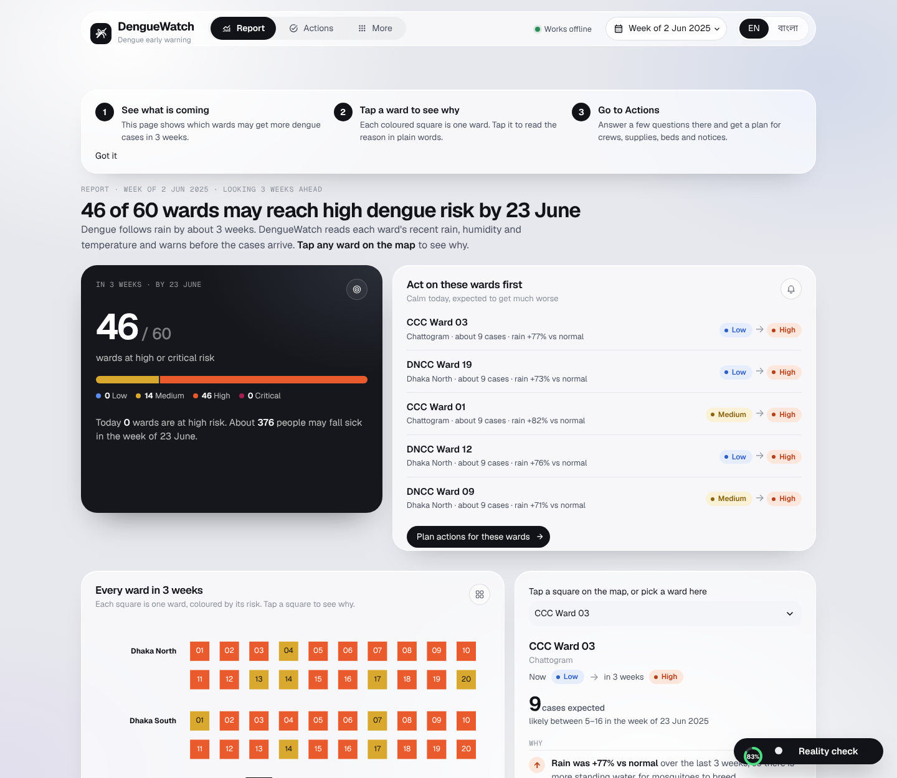
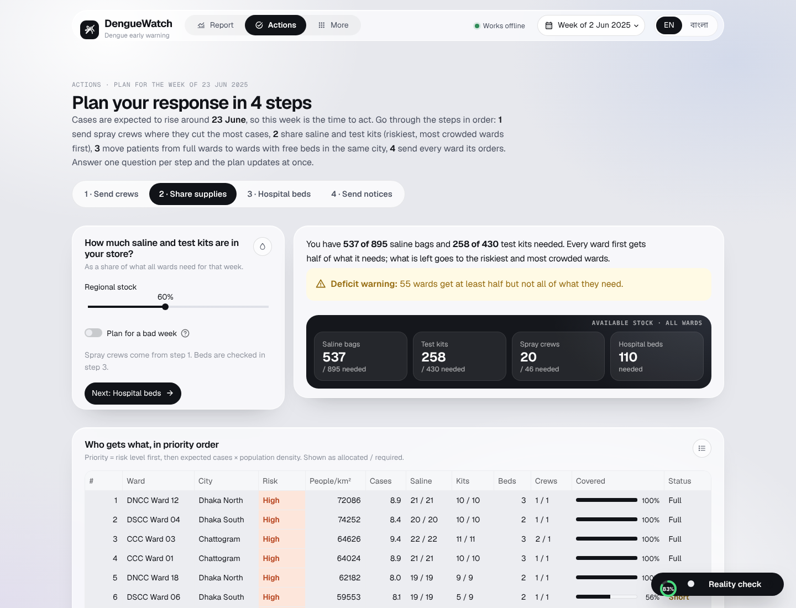

# DengueWatch: Ward-level Dengue Early Warning

[](https://github.com/Armanbro007/dengue-early-warning/actions/workflows/tests.yml)
[](https://github.com/Armanbro007/dengue-early-warning/actions/workflows/quickstart.yml)

**Rain today shows up as dengue cases in about three weeks.** DengueWatch uses that lag to forecast dengue cases for every ward in Dhaka North, Dhaka South, Chattogram, Gazipur and Narayanganj **2, 3 and 4 weeks ahead**. It ranks wards as Low / Medium / High / Critical, explains *why* each ward is at risk, and drafts an action briefing. City health officers can then send larvicide teams and hospital supplies to the right wards *before* admissions spike.

**Phase 2 (onsite final): a command center.** Knowing cases will rise is only useful if officers know what to send. DengueWatch now turns each forecast into **saline, test kit, bed and spraying-crew allocations under real stock limits**, **routes hospital overflow to wards with free beds in the same city**, **simulates what spraying crews would prevent 2-4 weeks later**, and writes **SMS, WhatsApp and printable dispatch notices** for every ward. All of it runs offline.

Built for the **EDU AI Engineering Hackathon 2026** ("AI for Urban Dengue Outbreak": Phase 1 early warning, Phase 2 onsite command center) by team **Vibe Engineers**.

**Live demo: [denguewatchedu.streamlit.app](https://denguewatchedu.streamlit.app/)** (free hosting: if the app is asleep, press the wake-up button and give it about a minute).



**Two languages.** A switch at the top right shows the whole dashboard in **English or Bangla (বাংলা)**, including the officer briefing, chart labels, dates and numbers. The Bangla is written the way a city corporation health office would say it, not translated word for word. Your city, week and look-ahead settings stay the same when you switch.

## Quick start (about 2 minutes)

Requires **Python 3.10 or newer** (checked on 3.11 to 3.15) and git. No API keys needed. These exact steps run on fresh Windows, macOS and Linux machines on every push (see the *readme quick start* badge above).

```bash
git clone https://github.com/Armanbro007/dengue-early-warning.git
cd dengue-early-warning
```

Then run these three commands from inside that folder. They use the environment's Python directly, so there is nothing to activate (this also avoids PowerShell's "running scripts is disabled" error).

| | Windows (PowerShell or Command Prompt) | macOS / Linux |
|---|---|---|
| 1. Create the environment | `py -m venv .venv` | `python3 -m venv .venv` |
| 2. Install | `.venv\Scripts\python -m pip install -r requirements.txt` | `.venv/bin/python -m pip install -r requirements.txt` |
| 3. Start | `.venv\Scripts\python -m streamlit run app.py` | `.venv/bin/python -m streamlit run app.py` |

**Open http://localhost:8501 in your browser** once the terminal says "You can now view your Streamlit app". The dataset (`data/`) and trained models (`models/`) are included, so nothing else is downloaded. Install takes 1 to 2 minutes on a normal connection; the app itself is ready in a few seconds. If your scikit-learn version differs from ours, the app retrains its models on first start (about 10 seconds).

**If something goes wrong**

- *"'py' is not recognized"* on Windows: Python is not installed. Install it from python.org (3.12 is a safe choice), open a new terminal and run step 1 again. If you ticked "Add python.exe to PATH" when installing, `python -m venv .venv` works too.
- *"Python was not found; run without arguments to install from the Microsoft Store"*: you typed `python` instead of `py`. Use `py -m venv .venv` as in step 1.
- *"ensurepip is not available"* on Ubuntu or Debian: run `sudo apt install python3-venv`, then step 1 again.
- *"Port 8501 is not available"*: an older copy of the app is still running. Close that terminal (or press Ctrl+C in it) and start again. To use another port instead: add `--server.port 8502` to the run command.
- *You see an old version of the dashboard*: same cause as above, or an old download. Stop every running copy, run `git pull` in the folder, and start again.
- Always run the commands from inside the `dengue-early-warning` folder, so the app finds its settings, fonts and models.

Optional (use the same `.venv\Scripts\python` or `.venv/bin/python` in place of `python`):

```bash
cp .env.example .env        # (Windows: copy .env.example .env) then add GEMINI_API_KEY for AI-worded briefings
python scripts/train.py     # rebuild features, evaluation (metrics.json) and models (~35 s)
python -m pytest            # 58 tests: lag correctness, no leakage, explanations, retries/fallbacks, allocation, routing,
                            #   crew simulator, notices, a no-internet kill-switch run, every page in English and Bangla
python scripts/export_dispatch.py --stock 60 --crews 20 --beds 80   # write sample notices to exports/
python scripts/ingest.py new_weeks.csv   # add new weekly data and retrain (--reset to undo)
```

Set `ALLOW_NETWORK=0` in `.env`, or switch on **Offline mode** in the week menu (top right), to run fully offline.

## What the dashboard does

Built so a ward officer can use it **without training**: no sidebar, three tabs at the top and one floating switch.

| Where | What an officer gets |
|---|---|
| **Report** | The answer in one sentence ("46 of 60 wards may reach high dengue risk by 23 June"), the wards to act on first, and all 60 wards as coloured squares. Tap a ward to read **why** in plain words (rain vs normal, drainage and crowding) and **what it will need** (crews, saline, kits, beds). A 3-step "Start here" guide greets first-time visitors. |
| **Actions** | Four steps, one plain question each, results update the moment an answer changes: **1 Send crews** (what-if simulator: cases, beds and saline prevented over weeks 2-4, ROI ranking, pick wards yourself), **2 Share supplies** (30-100% stock slider, risk-and-density priority, live **CRITICAL deficit** alerts), **3 Hospital beds** (overflow patients routed to wards with free beds **in the same city**, net deficits, city bed use and beds left), **4 Send notices** (printable HTML/PDF notice, WhatsApp, SMS in English and Bangla, ZIP of all 60, and an email / WhatsApp send box). |
| **Reality check** (floating switch, bottom right) | Shows the accuracy at a glance (share of real high-risk wards warned in time). Switch it on and the ward map turns *warned / missed / false alarm / calm*, and a card compares expected vs real cases and saline for that week and what the crews would have saved. |
| **More** | Ward table, season calendar, accuracy report, one ward in depth, the full reality comparison and system status. *Update weekly data* and *Live weather* are marked coming soon: every core function runs on the 2016-2025 data, offline. |

Report week, look-ahead (2-4 weeks), city and the **Offline mode** kill switch are in the week menu at the top right. Every page is in English and Bangla.



How each module works, the assumptions (bed capacity, crew effect) and timings are in [ARCHITECTURE.md, section 7](ARCHITECTURE.md#7-phase-2-from-forecast-to-action-command-center).

The dashboard opens on **2 June 2025**, a week the model never saw during training. 56 of the 60 wards were still Low that week. The system flagged 46 wards as High for 23 June, and 52 of the 60 wards actually reached High or Critical.

## How it works (short version)

1. **Weather lag pipeline** (`src/dengue/features.py`): rainfall lags of 0-6 weeks, humidity lags of 0-4 weeks, temperature lags and rolling rain totals, computed **per `ward_id`**, plus ward vulnerability and season.
2. **Prediction engine** (`src/dengue/model.py`, `engine.py`): gradient-boosted trees with a Poisson loss, one per horizon, with monotonic constraints (more rain never lowers risk). Saved with joblib. The 80% ranges are calibrated on years the model did not train on.
3. **Tiers and explanations** (`tiers.py`, `explain.py`): Low < 2, Medium 2-5, High 5-10, Critical ≥ 10 cases per ward per week. Exact Shapley contributions of each driver group.
4. **Validation** (`evaluate.py`): trained 2016-2022, tuned 2023, tested on 2024-2025 (never shuffled).

| Test 2024-2025, 3 weeks ahead | DengueWatch | Naive "same as this week" |
|---|---|---|
| MAE in monsoon season (Jun-Oct), cases/ward/week | **2.19** | 4.14 |
| MAE, all weeks | **1.02** | 1.87 |
| High/Critical ward-weeks caught (recall) | **85%** | 61% |

Details, diagrams and the efficiency and failure-handling design are in **[ARCHITECTURE.md](ARCHITECTURE.md)**.

## Project structure

```
app.py                  Streamlit entry (top tabs: Report, Actions, More)
ui_shell.py             top bar, week menu, start-here guide
ui_map.py               the 60-ward grid you can tap
ui_reality.py           floating Reality check switch and card
ui_common.py            cached engine, chart styling, shared controls
views/                  one file per dashboard page
ui_text.py              every English and Bangla string on the dashboard
static/fonts/           bundled fonts, so the design works offline
src/dengue/
  config.py             all settings: horizons, tiers, split dates, network limits
  data.py               load + validate the dataset (local CSV, sheet fallback)
  features.py           per-ward lag features, targets, seasonal reference
  model.py              train / save / load / predict, conformal ranges
  evaluate.py           chronological metrics, baselines, backtest
  engine.py             prediction engine used by the UI (and a future API)
  explain.py            Shapley driver breakdown, rain what-if
  tiers.py              risk tiers + escalation flags
  briefing.py           officer briefing (English/Bangla): template or optional cached LLM
  i18n.py               Bangla names, digits and dates shared by the briefing and the pages
  ingest.py             add new weekly data, retrain, reset
  supply.py             Phase 2 module 1: learned supply ratios, priority allocation under scarcity
  overflow.py           module 2: bed overflow routing inside each city
  simulator.py          module 3: model-driven crew what-if and ROI
  operations.py         modules 1-3 combined into one plan per week
  dispatch.py           module 4: SMS, Bangla SMS, WhatsApp, HTML/PDF briefs, exports
  weather_api.py        Open-Meteo client with cache and fallbacks
  http.py               retries, backoff, Retry-After, circuit breaker
scripts/train.py        rebuild models + models/metrics.json
scripts/ingest.py       add new weekly data from the command line
scripts/export_dispatch.py  write sample dispatch notices to exports/ (offline)
ui_ops.py               shared controls and cached plan for the command-center pages
exports/                sample SMS, WhatsApp, briefs (HTML + PDF), plan and bed transfers
tests/                  pytest suite (also run by GitHub Actions on Linux and Windows)
data/                   official onsite dataset (60 wards × 522 weeks, with saline, kit and bed needs)
models/                 trained model bundle + evaluation metrics
```

## AI tools and external services disclosure

| Tool / service | Type | What it was used for |
|---|---|---|
| **Claude (Anthropic), via Claude Code** | AI coding assistant | Phase 1 and Phase 2: analysing the brief and dataset, planning the architecture, and writing most of the code, tests and documentation under the team's direction. The team reviewed, ran and can explain all code. |
| **Google Gemini API** (`generativelanguage.googleapis.com`, default model `gemini-3.5-flash-lite`, set by `GEMINI_MODEL`) | LLM API, **optional, off by default** | Rewording the officer briefing in plain language from model numbers only. Used only if `GEMINI_API_KEY` is set (the "Reword with AI" switch appears only then); otherwise a template is used. **Not used by any Phase 2 module**: allocation, routing, the simulator and dispatch notices are plain code and templates. |
| **Open-Meteo Forecast API** (`api.open-meteo.com`) | Weather API, free, no key | Live weather for the Live forecast page. |
| **Google Sheets CSV export** | Dataset source | Official hackathon dataset; downloaded only if `data/bangladesh_dengue.csv` is missing. |

No other AI services or external APIs are used. Open-source libraries: pandas, NumPy, scikit-learn, joblib, PyArrow, Streamlit, Plotly, Requests, python-dotenv, pytest and fpdf2 (PDF briefs, optional) (see `requirements.txt`). Fonts: Geist, Geist Mono and Noto Sans Bengali (SIL Open Font License, bundled in `static/fonts`). No significant third-party code snippets were copied.

## Limitations and honest notes

- The dataset is the organisers' ward-week dataset (2016-2025). It has density but no population counts, so we forecast case **counts**, not incidence per 100k.
- Live mode uses city-level weather for all wards in a city. Ward differences come from ward attributes.

