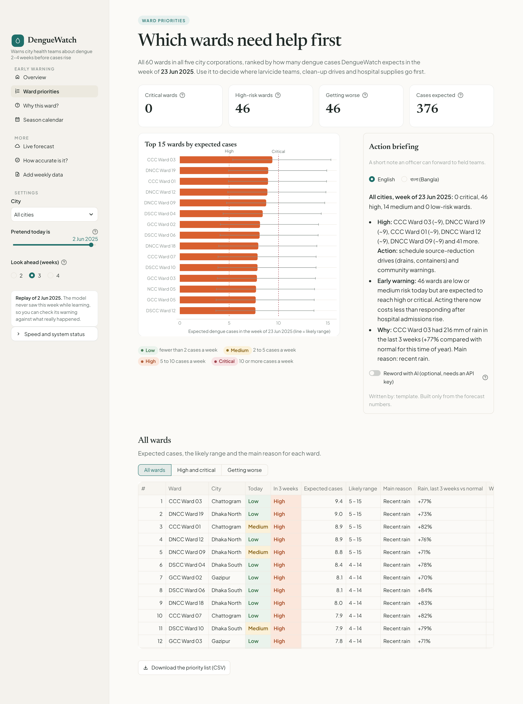

# DengueWatch: Ward-level Dengue Early Warning

[](https://github.com/Armanbro007/dengue-early-warning/actions/workflows/tests.yml)

**Rain today shows up as dengue cases in about three weeks.** DengueWatch uses that lag to forecast dengue cases for every ward in Dhaka North, Dhaka South, Chattogram, Gazipur and Narayanganj **2, 3 and 4 weeks ahead**. It ranks wards as Low / Medium / High / Critical, explains *why* each ward is at risk, and drafts an action briefing. City health officers can then send larvicide teams and hospital supplies to the right wards *before* admissions spike.

Built for the **EDU AI Engineering Hackathon 2026, Phase 1: "AI for Urban Dengue Outbreak"** by team **Vibe Engineers**.



## Quick start (about 2 minutes)

Requires **Python 3.10 - 3.14** and git. No API keys needed. Tested on every push on Linux and Windows (see the *tests* badge above).

```bash
git clone https://github.com/Armanbro007/dengue-early-warning.git
cd dengue-early-warning
python -m venv .venv
# Windows:      .venv\Scripts\activate
# macOS/Linux:  source .venv/bin/activate
pip install -r requirements.txt
streamlit run app.py
```

**Windows tip:** if `python` says "Python was not found" (the Microsoft Store shortcut), use the Python launcher instead: `py -m venv .venv`, and later `py -m streamlit run app.py`. If the `streamlit` command is not on your PATH, `python -m streamlit run app.py` always works.

The dashboard opens at http://localhost:8501. The dataset (`data/`) and trained models (`models/`) are included, so nothing else needs to be downloaded. If your scikit-learn version differs from ours, the app retrains its models automatically on first start (about 10 seconds).

Optional:

```bash
cp .env.example .env        # (Windows: copy .env.example .env) then add GEMINI_API_KEY for AI-worded briefings
python scripts/train.py     # rebuild features, evaluation (metrics.json) and models (~35 s)
python -m pytest            # 32 tests: lag correctness, no leakage, explanations, retries/fallbacks, every page loads
python scripts/ingest.py new_weeks.csv   # add new weekly data and retrain (--reset to undo)
```

Set `ALLOW_NETWORK=0` in `.env` to run fully offline.

## What the dashboard does

| Page | What an officer gets |
|---|---|
| **Ward Risk Board** | Pick city, week and horizon. All wards are ranked by forecast cases with 80% ranges and tiers. **Escalating** wards (Low/Medium today, High+ soon) are flagged. Includes an action briefing in **English or Bangla** and a CSV export. |
| **Ward Drivers & What-if** | A waterfall showing how rainfall, humidity, temperature and ward vulnerability push the forecast above or below the seasonal norm; the "breeding clock" rain chart; a rain what-if slider; forecast-vs-actual track record. |
| **Season Heatmap** | Every ward × every week of a season, coloured by forecast tier (or actual tier, or forecast error). |
| **Live Forecast (API)** | The same model fed with this week's real and forecast weather from Open-Meteo: one API call for all cities, cached, with offline fallbacks. |
| **Model Accuracy** | Chronological test results vs naive baselines, year-by-year backtest, lag-correlation evidence, tier confusion matrix. |
| **Add Weekly Data** | Upload the latest ward reports (CSV). The file is checked, merged and the models retrain in about 15 s. Reset any time. |

The dashboard opens on **2 June 2025**, a week the model never saw during training. 56 of the 60 wards were still Low that week. The system flagged 46 wards as High for 23 June, and 52 of the 60 wards actually reached High or Critical.

## How it works (short version)

1. **Weather lag pipeline** (`src/dengue/features.py`): rainfall lags of 0-6 weeks, humidity lags of 0-4 weeks, temperature lags and rolling rain totals, computed **per `ward_id`**, plus ward vulnerability and season.
2. **Prediction engine** (`src/dengue/model.py`, `engine.py`): gradient-boosted trees with a Poisson loss, one per horizon, with monotonic constraints (more rain never lowers risk). Saved with joblib. The 80% ranges are calibrated on years the model did not train on.
3. **Tiers and explanations** (`tiers.py`, `explain.py`): Low < 2, Medium 2-5, High 5-10, Critical ≥ 10 cases per ward per week. Exact Shapley contributions of each driver group.
4. **Validation** (`evaluate.py`): trained 2016-2022, tuned 2023, tested on 2024-2025 (never shuffled).

| Test 2024-2025, 3 weeks ahead | DengueWatch | Naive "same as this week" |
|---|---|---|
| MAE in monsoon season (Jun-Oct), cases/ward/week | **2.19** | 4.14 |
| MAE, all weeks | **1.02** | 1.87 |
| High/Critical ward-weeks caught (recall) | **85%** | 61% |

Details, diagrams and the efficiency and failure-handling design are in **[ARCHITECTURE.md](ARCHITECTURE.md)**.

## Project structure

```
app.py                  Streamlit entry (navigation + shared controls)
ui_common.py            cached engine, chart styling, sidebar
views/                  one file per dashboard page
src/dengue/
  config.py             all settings: horizons, tiers, split dates, network limits
  data.py               load + validate the dataset (local CSV, sheet fallback)
  features.py           per-ward lag features, targets, seasonal reference
  model.py              train / save / load / predict, conformal ranges
  evaluate.py           chronological metrics, baselines, backtest
  engine.py             prediction engine used by the UI (and a future API)
  explain.py            Shapley driver breakdown, rain what-if
  tiers.py              risk tiers + escalation flags
  briefing.py           officer briefing (English/Bangla): template or optional cached LLM
  ingest.py             add new weekly data, retrain, reset
  weather_api.py        Open-Meteo client with cache and fallbacks
  http.py               retries, backoff, Retry-After, circuit breaker
scripts/train.py        rebuild models + models/metrics.json
scripts/ingest.py       add new weekly data from the command line
tests/                  pytest suite (also run by GitHub Actions on Linux and Windows)
data/                   official hackathon dataset (60 wards × 522 weeks)
models/                 trained model bundle + evaluation metrics
```

## AI tools and external services disclosure

| Tool / service | Type | What it was used for |
|---|---|---|
| **Claude (Anthropic), via Claude Code** | AI coding assistant | Analysing the brief and dataset, planning the architecture, and writing most of the code, tests and documentation under the team's direction. The team reviewed, ran and can explain all code. |
| **Google Gemini API** (`generativelanguage.googleapis.com`, default model `gemini-2.5-flash`) | LLM API, **optional, off by default** | Rewording the officer briefing in plain language from model numbers only. Used only if `GEMINI_API_KEY` is set; otherwise a template is used. |
| **Open-Meteo Forecast API** (`api.open-meteo.com`) | Weather API, free, no key | Live weather for the Live Forecast page. |
| **Google Sheets CSV export** | Dataset source | Official hackathon dataset; downloaded only if `data/bangladesh_dengue.csv` is missing. |

No other AI services or external APIs are used. Open-source libraries: pandas, NumPy, scikit-learn, joblib, PyArrow, Streamlit, Plotly, Requests, python-dotenv, pytest (see `requirements.txt`). No significant third-party code snippets were copied.

## Limitations and honest notes

- The dataset is the organisers' ward-week dataset (2016-2025). It has density but no population counts, so we forecast case **counts**, not incidence per 100k.
- Live mode uses city-level weather for all wards in a city. Ward differences come from ward attributes.
- November is dry season, so live risk is Low right now. The historical replay shows how the system behaves during the monsoon.
- Forecast ranges are 80% ranges: about 1 in 5 weeks will fall outside them.
